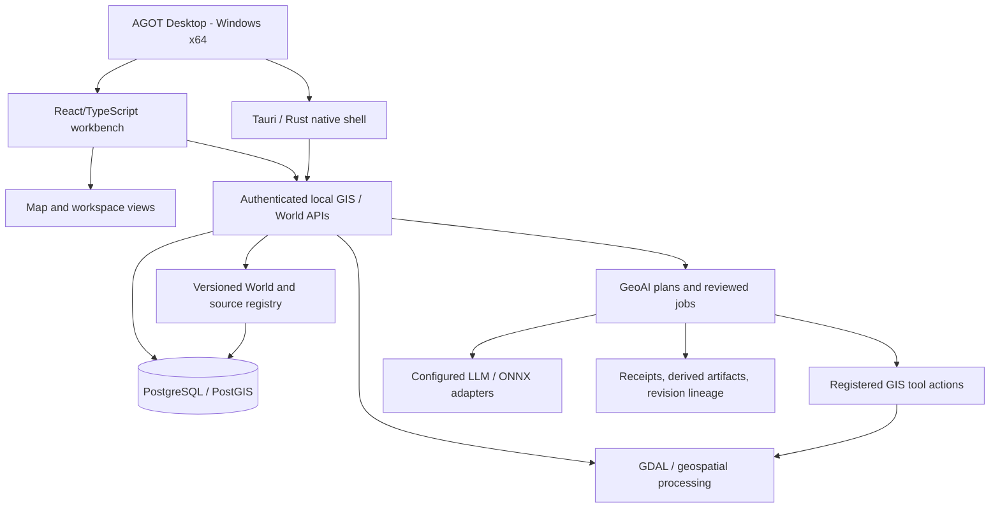

# AGOT architecture — boundaries and evolution

This is a **public, high-level architectural description** derived from published release notes and reviewed development status, not a source-code dump or a claim that every subsystem is independently production-certified.

## System shape

Architecture varies with release, local system configuration and user permissions. The diagram shows conceptual boundaries rather than a public API contract.

## Main design contracts

**Desktop shell and workbench.** Tauri 2 hosts a React/TypeScript application with project management, workspace navigation, map/imagery/twin/scenario surfaces, GIS tool forms and results. Windows WebView2 availability affects startup. Not all advanced views have passed installed-native acceptance.

**Spatial back end.** Local services supply authenticated API access, project/dataset reads, geoprocessing and persisted World/scene operations. PostgreSQL/PostGIS and a compatible GIS runtime are significant integration dependencies. Workstation “offline” should not be interpreted as “every source or tool works with no network.”

**Identity and history.** Canonical entities, immutable/source-backed World membership, version IDs, branch/correction operations and valid/historical reads support traceability. Claims of fully portable signed Worlds, universal conflict handling and complete cross-world coupling remain gated.

**Tool-based GeoAI.** The agent layer reads authorized data and tool contracts; human-reviewed effectful steps create durable jobs and derived artifacts. Evidence receipts associate inputs, outputs, hashes and authority decisions. Hash integrity is not an independent certification or signature.

**Models and inference.** Local provider endpoints and ONNX runtimes have explicit contracts and operational constraints. Model availability and real inference accuracy require independent testing. No licensed production segmentation checkpoint is bundled in Preview 3.

**Visualization.** The present product uses map-first GIS surfaces and developing terrain/3D paths. More advanced source code integrates MapLibre, Three.js and Cesium in distinct view engines; presence in the private draft development branch **must not** be conflated with shipped, universally synchronized Preview 3 capability.

## Engineering invariants

1. No unauthorized source fetch, credential leak or irreversible dataset mutation.
2. Every derived spatial document retains source lineage and revision history.
3. User approves lasting side effects; failed/cancelled jobs expose reason and state.
4. Valid/recorded times and coordinate/vertical reference assumptions are explicit.
5. Re-running the same authorized job must be distinguishable from a new operation.
6. Unknown coverage is never converted silently into fabricated real-world data.
7. Raster, 3D, agent and simulation claims require separate engine-appropriate validation.

## Environment and performance

Local deployment is designed around Windows desktops with GIS/runtime dependencies and potentially large installed packages; some operations require internet services, local model configuration or GPU acceleration. The project does **not** assert a universal minimum GPU, low memory footprint or unlimited city-scale renderer performance for Preview 3.

See [Capabilities](CAPABILITY_MATRIX.md), [Quality gates](QUALITY_AND_LIMITATIONS.md) and [Roadmap](../ROADMAP.md).
